# gravity-fusion 조합 계획 (v2, ulw-plan 형식)

> 승인: 사용자가 이 자리에서 사전 승인함. 질문 없이 바로 실행한다.
> 작업 루트: `C:\Users\Daeryun\.gemini\antigravity\scratch\gravity-fusion` (git, `main`)
> 원본: native-gravity `bc1d8ad010ef1cd336eac9acb4a8ca97c315e125` (원격 main HEAD와 일치 확인), lazyantigravity 0.9.0

## 0. 한 줄 요약

native-gravity의 9개 역할 에이전트와 4개 품질 훅을 **Windows·PowerShell·AGY hub-2.21.0에서 실제로 동작하도록 Node로 옮기고**, 역할마다 lazyantigravity 스킬·MCP 도구를 연결한 **새 독립 플러그인 `gravity-fusion`**을 만든다. 설치된 lazyantigravity는 건드리지 않는다.

## 1. 최종 사용자와 사용 장면

| ID | 사용자 | 지금 쓰는 방식 | 이 결과물에서 바라는 것 |
|---|---|---|---|
| U1 | 운영자 Daeryun (Windows, AGY IDE, 한국어) | 대부분 Default 에이전트. lazyantigravity 스킬·MCP 상시 사용 | 무거운 작업에서만 Bulldozer/Piledriver/Excavator를 고른다. Default 세션은 지금과 똑같아야 한다 |
| U2 | 역할을 맡은 호스트 모델 (primary) | 에이전트 본문을 시스템 프롬프트로 받는다 | 본문의 명령이 PowerShell에서 그대로 돌아가고, 있는 도구만 언급되고, 종료 문자열이 명확해야 한다 |
| U3 | 서브에이전트 (Jaguar, Puma, Zen 등) | 좁은 도구 집합 | 없는 도구를 쓰라는 지시가 없어야 하고, 거부됐을 때 대처법이 적혀 있어야 한다 |
| U4 | AGY 훅 런타임 | `cmd /c`로 훅 실행, cwd = hooks.json 폴더 | 빠르고(지연 예산 내) 항상 유효한 JSON. 실패 시 정해진 방향(fail-open/closed)으로 |
| U5 | 함께 설치된 lazyantigravity | 자체 훅·MCP·스킬 | 충돌·중복 차단·무한 루프가 없어야 한다 |
| U6 | 유지보수자 (미래의 Daeryun/에이전트) | upstream이 바뀌면 다시 이식 | 원본 고정(lock), 드리프트 검사, 테스트 한 번에 재현 |

### 사용 장면에서 걸리는 지점 (현재 native-gravity를 그대로 Windows에 깔았을 때)

1. `hooks.json`이 `python3 ./hooks/*.py`를 호출한다. 이 PC의 `python3`은 WindowsApps 별칭이라 훅이 조용히 실패한다. 게이트·가드가 전부 꺼진 것과 같다.
2. 에이전트 본문이 `NTG_ZEN_VERIFY=1 cat ...` 같은 POSIX 접두를 지시한다. PowerShell에서는 문법 오류다. 모델이 매번 우회하다 가드 경계가 무의미해진다.
3. 플러그인 루트 `rules/`는 **모든 세션에 상시 주입**된다. Default 세션에도 Bulldozer 전용 규칙 8KB와 하네스 14KB가 들어가 U1의 평소 경험이 바뀐다.
4. hub-2.21.0 트랜스크립트는 `tool_calls[].args` 값이 JSON 문자열로 한 번 더 감싸여 있다. upstream 게이트는 `TypeName == "zen"` 비교에 실패해 Zen 검토를 못 본다. 결과적으로 READY를 영원히 막거나(무한 continue) 반대로 놓친다.
5. `skills/*.md`에 frontmatter가 없어 스킬로 로드되지 않는다. 하네스가 가리키는 QA 스킬이 없는 셈이다.
6. lazyantigravity의 스킬·MCP가 있는데도 역할 본문은 그 존재를 모른다.

## 2. 이상 상태 (IS) — 사용자 입장에서 걸림·이상함·리그레션·열화가 없는 상태

| IS | 정의 | 이유 (어떤 사용자의 어떤 문제를 막는가) |
|---|---|---|
| IS-1 | Default 세션에 상시 주입되는 규칙 0개. 모든 훅은 역할이 식별되지 않으면 즉시 통과(allow/stop) | U1의 평소 경험 보존. 리그레션 금지 |
| IS-2 | 런타임 의존은 Node(≥18)뿐. Python·npm 패키지 불필요 | U4: `python3` 별칭 문제 제거. lazyantigravity가 이미 Node를 요구하므로 추가 비용 없음 |
| IS-3 | 모든 마커·명령 예시가 PowerShell에서 문법상 유효 (`$env:NTG_ZEN_VERIFY='1'; ...`). 가드는 POSIX 형식도 계속 인식 | U2가 지시대로 실행 가능. upstream 호환 |
| IS-4 | POSIX 입력에 대해 Node 훅의 판정이 Python 원본과 1:1 동일 (차등 테스트로 입증) | 이식 중 보안 의미가 바뀌지 않았음을 증명 |
| IS-5 | 에이전트 `tools`에는 이 빌드에 실제로 있는 이름만. 읽기 전용 역할에는 쓰기 도구 없음. 역할별 lazy 스킬·MCP 매핑이 본문에 있음 | U3: 없는 도구 지시 제거. 권한 경계 유지 |
| IS-6 | 게이트는 역할 범위로만 작동, 무한 continue 루프 없음, GO 이후 변경 시 stale 판정 유지. hub-2.21.0 트랜스크립트에서 Zen 호출·판정을 정확히 인식 | U2가 끝없이 붙잡히거나 검토 없이 끝나는 일 방지 |
| IS-7 | lazyantigravity 훅과 공존: 서로의 판정을 뒤집거나 중복 차단하지 않음 | U5 |
| IS-8 | 이름 충돌 검사 (에이전트·스킬·플러그인 이름). 새 스킬은 `gf-` 접두 | U1: 다른 플러그인과 섞여도 혼동 없음 |
| IS-9 | `UPSTREAM.lock.json`에 원본 커밋·파일별 SHA-256 고정, `check-upstream`으로 드리프트 감지 | U6 |
| IS-10 | 한국어 README: 설치·사용·문제 해결·MCP 권한·라이브 검증 절차 | U1 |
| IS-11 | `npm test`, `npm run verify` 녹색. `verify-live` 스크립트 준비 | U6, 완료 증거 |
| IS-12 | 훅 1회 실행 p95 < 300ms (Windows, node 콜드 스타트 포함) | U4: 매 도구 호출마다 붙는 지연 최소화 |
| IS-13 | Zen 가드를 통해서는 어떤 변경도 불가 (적대적 우회 시도 전부 deny) | 독립 검토자의 읽기 전용 보장 |
| IS-14 | Excavator 가드가 Windows 권한 상승·히스토리 탈취·전체 업그레이드 패턴을 인식 | Windows에서도 upstream과 같은 안전선 |
| IS-15 | 생성된 모든 에이전트가 실행기 초기화에 실패하지 않음. 실패 가능성이 보고된 도구 이름(`call_mcp_tool`)은 기본 빌드에서 제외, 라이브 프로브 후에만 opt-in | antigravity-cli #783: `tools:`에 `call_mcp_tool`을 넣으면 `no tool converter registered`로 에이전트 시작 자체가 실패한 사례. 이 빌드에도 같은 오류 문자열이 존재함(`.omo/research/ls-binscan3.txt`) |

## 3. 현재 대비 갭 (전수)

| 갭 | 현재 | 이상 | 해당 IS | 이유 |
|---|---|---|---|---|
| G1 | 훅이 `python3` 호출 | `node hooks/*.mjs` | IS-2 | Windows에서 훅 무력화 |
| G2 | POSIX 마커 지시 (`excavator.md:82`, `zen.md:25`, `orchestration.md:109`) | PowerShell 마커 + 가드 이중 인식 | IS-3 | 문법 오류 |
| G3 | Zen 가드 문법이 POSIX shlex 전용 | PowerShell 허용 목록 문법 추가, 기본 거부 | IS-3, IS-13 | PowerShell 명령은 판정 불가 → 모두 deny 되거나 우회 |
| G4 | Excavator 가드가 sudo/apt 등만 인식 | runas, gsudo, `Start-Process -Verb RunAs`, `ConsoleHost_history.txt`, `winget upgrade --all` 등 추가 | IS-14 | Windows 패턴 미인식 |
| G5 | 게이트가 hub-2.21.0 args 이중 인코딩을 못 읽음 | 문자열 인자 값 JSON 디코드 | IS-6 | Zen 검토 미인식 |
| G6 | 역할 식별이 시스템 프롬프트 서명·identity 키에 의존 (hub 트랜스크립트엔 둘 다 없음) | 첫 MODEL 응답 첫 줄 `NTG_ROLE: <role>` 배너 채널 추가 | IS-6 | 역할 식별 불가 → 게이트 무동작 |
| G7 | 루트 `rules/`가 모든 세션에 상시 주입 | 루트 `rules/` 없음. 빌드 시 역할 본문에 인라인 | IS-1 | Default 세션 리그레션 |
| G8 | `skills/*.md` frontmatter 없음 | `skills/gf-qa-*/SKILL.md` | IS-5, IS-8 | 스킬 미로드 |
| G9 | sudo·tee·heredoc 지시 (`excavator.md:84,86,93`, `bobcat.md:52`, `harness.md:107`) | Windows 대응 지시 (승격 불가 시 BLOCKED 보고, 파일 쓰기는 쓰기 도구) | IS-3 | 실행 불가 지시 |
| G10 | 역할 본문이 lazy 스킬·MCP를 모름 | 역할별 매핑 섹션 + MCP 거부 시 대처 | IS-5 | 도구 미활용 |
| G11 | MCP 권한 경계 없음 | `mcp-role-guard`: 읽기 전용 역할은 읽기 전용 MCP만 | IS-5, IS-13 | opt-in MCP 모드에서 우회 경로 차단 |
| G12 | 원본 고정·드리프트 검사 없음 | lock + check-upstream | IS-9 | 유지보수 |
| G13 | 한국어 문서 없음 | README.ko | IS-10 | 운영자 |
| G14 | `ntg-run` 러너가 Windows에서 `spawnSync agy` 실패 (12/42) | 범위 밖으로 명시. 역할 선택은 IDE 드롭다운(`mainAgent: true`) | — | `agy` CLI가 이 PC에 없음. 러너 이식은 별도 과제 |
| G15 | 훅 지연 측정 없음 | perf 테스트 | IS-12 | U4 |
| G16 | `call_mcp_tool` 부여 시 시작 실패 위험 | 기본 제외 + `gf-mcp-probe` 에이전트 + `--mcp` 빌드 옵션 | IS-15 | #783 |

## 4. 잠근 설계 결정

| D | 결정 | 이유 |
|---|---|---|
| D1 | 새 플러그인 `gravity-fusion`, scratch 저장소에서 빌드. 전역 설치는 사용자 단계 | 전역 저장소 쓰기는 사용자가 디렉터리를 지목해야 함 (RULES) |
| D2 | 루트 `rules/` 없음. `harness.md`는 9개 전부, `orchestration.md`는 bulldozer·piledriver·steamroller 본문에 인라인. frontmatter `rules:` 제거 | IS-1. orchestration은 Bulldozer 실행 흐름 전용이라 리뷰어(Zen 등)에게는 잡음 |
| D3 | 훅 전부 Node `.mjs`, 의존성 0 | IS-2 |
| D4 | PowerShell 마커 `$env:NTG_ZEN_VERIFY='1'; <cmd>` / `$env:NTG_EXCAVATOR='1'; <cmd>`. 가드는 POSIX 형식도 인식 | IS-3, IS-4 |
| D5 | Zen PowerShell 문법: 허용 cmdlet 목록(대소문자 무시), 접두 제거 후 `$ \` ( ) { } [ ] @ # > < &`, `::`, `-Wait` 포함 시 거부, 구분자 `|` `;`, 기본 거부 | IS-13 |
| D6 | 공용 트랜스크립트 헬퍼를 `hooks/lib/transcript.mjs`로 추출 (두 게이트 Python 헬퍼를 diff 후 통합). 문자열 인자 값 JSON 디코드 | G5 |
| D7 | 역할 식별 채널: 페이로드 `roleHint`/`agentName`/identity 키 → 트랜스크립트 identity 키·서명 → 첫 USER_INPUT `NTG_ROLE` → **첫 MODEL 응답 첫 줄 `NTG_ROLE: <role>` 배너** | G6. Stop 페이로드에 에이전트 이름 없음 (PR #15 본문 확인) |
| D8 | 기본 빌드는 `call_mcp_tool`을 어떤 `tools`에도 넣지 않음. `gf-mcp-probe` 에이전트 동봉, `npm run build -- --mcp`로 opt-in | IS-15 |
| D9 | `mcp-role-guard.mjs` (PreToolUse): 배너로 식별된 읽기 전용 역할(jaguar, zen, steamroller, strix-halo, piledriver)은 읽기 전용 MCP 허용 목록만. 배너 없으면 allow | G11, IS-1 |
| D10 | upstream 에이전트 이름 유지, 서명 문장 원문 유지, 종료 문자열 불변 | 패리티 |
| D11 | 테스트 node:test. upstream 벡터 전부 이식 + Python 원본과의 차등 테스트 + PowerShell/Windows 벡터 + hub-2.21.0 픽스처 + Default 비리그레션 + 지연 | IS-4, IS-11, IS-12 |
| D12 | `ntg-run` 러너·spine·ledger(JS 오케스트레이터)는 이번 범위 밖 | `agy` CLI 부재. IDE 사용 시나리오에 불필요 |

### 역할 ↔ lazy 매핑 (본문에 주입)

| 역할 | 성격 | lazy 스킬 | MCP (opt-in 시) |
|---|---|---|---|
| bulldozer | 실행 primary | start-work, mass-ulw, git-master, review-work | 없음 |
| piledriver | 계획 primary | ulw-plan, init-deep | 없음 (Jaguar 위임) |
| excavator | 자율 디버깅 primary | debugging, programming, lsp-setup, report-bug | ast_grep, ast_index, lsp, git_bash, research |
| bobcat | 구현 | programming, refactor, frontend, remove-ai-slops | ast_grep, lsp, ast_index |
| puma | 단순 쓰기 | (skills: [] 유지) | 없음 |
| jaguar | 읽기 전용 탐색 | (skills: [] 유지) | 읽기 전용만 |
| steamroller | 감시/분해 | cove-verify, boost | 없음 |
| strix-halo | 심층 판정 | (skills: [] 유지) | 읽기 전용만 |
| zen | 독립 검토 | review-work, visual-qa | 읽기 전용만 |

## 5. 작업 DAG (mass-ulw)

```mermaid
flowchart LR
  W0["W0 계약 고정 (본체)"] --> W1
  subgraph W1["W1 병렬 7노드 (flash)"]
    N1["N1 스캐폴드·lock"]
    N2["N2 shell-lex + 차등"]
    N3["N3 io·transcript + 픽스처"]
    N9["N9 primaries 본문"]
    N10["N10 bobcat·puma·jaguar"]
    N11["N11 steamroller·strix·zen"]
    N12["N12 harness·orchestration·gf-qa"]
  end
  W1 --> W2
  subgraph W2["W2 병렬 5노드"]
    N4["N4 zen-shell-guard"]
    N5["N5 excavator-shell-guard"]
    N6["N6 primary-review-gate"]
    N7["N7 excavator-review-gate"]
    N8["N8 mcp-role-guard"]
  end
  W2 --> W3
  subgraph W3["W3 병렬 3노드"]
    N13["N13 build·hooks.json·verify"]
    N14["N14 verify-live·install·check-upstream"]
    N15["N15 README.ko"]
  end
  W3 --> W4["W4 검증 4노드 (flash 2 + pro 2)"]
  W4 --> FIX["수정 루프 (IS 전부 PASS까지)"]
```

- 노드 프롬프트는 TASK / DELIVERABLE / SCOPE / VERIFY / STOP WHEN 5필드. 쓰기 범위는 웨이브 안에서 서로 겹치지 않음.
- 노드 보고는 주장으로 취급. 본체가 직접 재실행해 확인한 뒤 원자 커밋.
- 공용 계약은 `contracts/conventions.md` (W0, 본체 작성).

## 6. QA 시나리오 (IS별, 타협 없음)

| IS | 시나리오 | 통과 기준 | 증거 |
|---|---|---|---|
| IS-1 | Default 에이전트 hub 트랜스크립트(배너 없음, READY로 끝남)를 5개 훅에 주입 | 전부 allow/stop, reason에 역할 언급 없음 | `test/default-nonregression.test.mjs` |
| IS-1 | `plugin/rules/` 존재 여부 | 없음 | `verify.mjs` |
| IS-2 | `plugin/` 안 `.py` 파일, `hooks.json`의 python 문자열 | 0개 | `verify.mjs` |
| IS-3 | 생성 에이전트 본문에서 `NTG_[A-Z_]+=1 ` POSIX 접두 지시 검색 | PowerShell 형식만 (호환 언급 문장 제외) | `verify.mjs` |
| IS-4 | 각 가드의 POSIX 벡터 전부를 Python 원본과 Node 포트에 동시에 넣기 | decision 100% 일치 | `test/differential.test.mjs` |
| IS-5 | 생성 에이전트 `tools`가 `contracts/agy-tools.json`의 부분집합, 읽기 전용 역할에 write/replace/run_command(zen 제외) 없음 | 위반 0 | `verify.mjs` |
| IS-6 | hub 픽스처: Zen 호출 없음 → continue / GO → stop / NO-GO → continue / GO 후 쓰기 → stale continue / BLOCKED → stop / 비정상 종료 → stop / fullyIdle=false | 각 기대값 | gate 테스트 |
| IS-6 | 같은 트랜스크립트로 continue를 연속 받는 경우 | reason이 매번 같은 교정 지시이고, 교정 이행 시 stop으로 바뀜 (루프 탈출 경로 존재) | gate 테스트 |
| IS-7 | lazy 훅 출력 형식(Claude 스키마)과 AGY 결정 키 비교 | 겹치는 차단 경로 없음 (문서 근거) | README 공존 절 |
| IS-8 | 설치된 플러그인 디렉터리와 이름 대조 | 충돌 0 | `verify-live.mjs` |
| IS-9 | 원본 파일 1바이트 변경 시뮬레이션 | check-upstream이 드리프트 보고, exit≠0 | `test/check-upstream.test.mjs` |
| IS-10 | README 필수 절 존재 | 설치/사용/문제 해결/MCP 권한/라이브 검증/제거 | `verify.mjs` |
| IS-11 | `npm test`, `npm run verify` | exit 0 | CLI 출력 |
| IS-12 | 훅별 30회 실행 | p95 < 300ms | `test/perf.test.mjs` |
| IS-13 | 적대적 Zen 우회 코퍼스 (리다이렉트, 서브식, `Set-Content`, `Out-File`, `Remove-Item`, `-Encoding` 꼼수, `git -c`, `git diff --output`, 유니코드 따옴표, 개행 삽입 등) | 전부 deny | zen 테스트 + pro 리뷰 |
| IS-14 | Windows 위험 패턴 코퍼스와 일반 명령 코퍼스 | 위험 전부 deny, 일반 전부 allow | excavator 가드 테스트 |
| IS-15 | 기본 빌드 `tools`에 `call_mcp_tool` | 0개. `--mcp` 빌드에서만 존재 | `verify.mjs` |

## 7. 라이브 검증 잔여 (설치 후에만 확인 가능, 추측하지 않음)

| L | 항목 | 확인 방법 |
|---|---|---|
| L1 | 이 빌드의 MCP 스텝이 훅에서 어떤 이름으로 보이는가 | `verify-live`의 훅 로그 모드 |
| L2 | `tools:`에 `call_mcp_tool`을 넣어도 시작되는가 | `gf-mcp-probe` 호출 |
| L3 | Windows에서 `commandExecutionPolicy: sandbox`의 실제 의미 | 역할 세션에서 명령 1회 |
| L4 | 플러그인 에이전트가 IDE primary 드롭다운에 보이는가 | 재시작 후 확인 |
| L5 | 훅 matcher가 정규식으로 해석되는가 | L1과 함께 |

## 8. Todo

| # | 항목 | 상태 |
|---|---|---|
| 1 | 조사 W0 (R1~R5) | 완료 |
| 2 | 계획 문서 | 완료 |
| 3 | 계약·ulw-loop 목표·ledger | 진행 |
| 4 | W1 (7노드) | 대기 |
| 5 | W2 (5노드) | 대기 |
| 6 | W3 (3노드) | 대기 |
| 7 | W4 검증 + 수정 루프 | 대기 |
| 8 | 품질 게이트·walkthrough·최종 보고 | 대기 |
